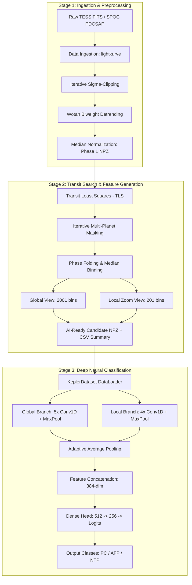

# AstroVet-ISRO: AI-Enabled Detection of Exoplanets

[](https://www.python.org/downloads/)
[](https://pytorch.org/)
[](https://opensource.org/licenses/MIT)
[](#testing-and-verification)
[](https://archive.stsci.edu/tess/)

> **An End-to-End Hybrid Astrophysical & Deep Learning Pipeline for Exoplanet Transit Detection and Classification from Space Telescope Light Curves.**
> Built for the **Bharatiya Antariksh Hackathon 2026 (ISRO × Hack2skill, Problem Statement 7)**.

---

## 1. Project Overview & Motivation

Space-based transit surveys such as NASA's **TESS** (Transiting Exoplanet Survey Satellite) and **Kepler** observe hundreds of thousands of stars simultaneously, generating millions of continuous photometric time series (light curves). Identifying genuine exoplanetary transits among these observations is challenging due to:
- High instrumental noise and spacecraft jitter (scattered light, momentum dumps).
- Complex stellar astrophysical variability (starspots, stellar pulsations, flares).
- Confounding astrophysical false positives (eclipsing binary stars, grazing eclipses, background blend stars).

**AstroVet-ISRO** solves this through a principled **three-stage hybrid architecture**:
1. **Classical Astrophysical Signal Processing:** Outlier sigma-clipping, multi-sector stitching, and robust non-parametric detrending using **Wotan biweight filtering**.
2. **Periodic Transit Search:** **Transit Least Squares (TLS)** search with iterative transit masking for multi-planet recovery and candidate characterization.
3. **Deep Learning Classification:** A **Dual-Branch 1D Convolutional Neural Network (AstroNetCNN)** ingesting dual-resolution representations (2001-point full-orbit global view + 201-point transit zoom) trained with class-weighted loss and learning rate scheduling to classify candidates into **Planet Candidates (PC)**, **Astrophysical False Positives (AFP)**, and **Non-Transiting Phenomena (NTP)**.

---

## 2. Key Features

- **Automated Data Ingestion:** Seamless integration with STScI MAST using `lightkurve` and `astroquery` to retrieve 2-minute SPOC PDCSAP light curves and TIC v8.2 stellar parameters ($T_{\text{eff}}$, $\log g$, $R_\star$, $M_\star$, crowding metrics).
- **Transit-Preserving Detrending:** Automated iterative $\sigma$-clipping and time-windowed biweight filtering via `wotan` to remove stellar variability without attenuating flat-bottomed transit dips.
- **TLS Periodic Signal Recovery:** Uses physical limb-darkened transit box shapes (rather than basic rectangular boxes) to extract period $P$, transit epoch $T_0$, transit depth $\delta$, duration, Signal Detection Efficiency (SDE), and Signal-to-Noise Ratio (SNR).
- **Trimodal Feature Representations:** Extracts standardized 2001-bin global phase-folded views and 201-bin local transit-centered zooms, matching established NASA/Google AstroNet conventions.
- **Dual-Branch PyTorch 1D CNN:** Deep convolutional neural network featuring GELU activations, Batch Normalization, residual skip projections, Adaptive Average Pooling, and a multi-layer classification head.
- **Production-Grade Training System:** Integrated with PyTorch Mixed Precision (AMP), gradient clipping, class-frequency weighting, Cosine Annealing learning rate schedule, atomic checkpointing, and structured CSV/JSON metrics logging.
- **Complete Test Suite:** Fully automated, offline-capable unit and integration test suite with `pytest`.

---

## 3. Architecture & Data Flow



---

## 4. Deep Learning Model Architecture (`AstroNetCNN`)

The neural classifier processes dual-resolution representations simultaneously to differentiate flat-bottom planetary transits from V-shaped eclipsing binaries and stellar variability:

```
                          ┌────────────────────────┐
                          │ Global View (1, 2001)  │
                          └───────────┬────────────┘
                                      │
                         5 × Conv1D Block + MaxPool
                         (Channels: 16→32→64→128→256)
                                      │
                         AdaptiveAvgPool1d(1) + Dropout
                                      │
                                  (B, 256)
                                      │
                          ┌───────────┴────────────┐
                          │   Feature Concatenation│ ── (B, 384)
                          └───────────┬────────────┘
                                      │
                         Classifier Head:
                         Dense(384 → 512) → BN → GELU → Dropout(0.5)
                         Dense(512 → 256) → BN → GELU → Dropout(0.5)
                         Dense(256 → 3)   → Raw Logits
                                      │
                          ┌───────────┴────────────┐
                          │   Predictions [PC/AFP/NTP]
                          └────────────────────────┘
                                      ▲
                                      │
                                  (B, 128)
                                      │
                         AdaptiveAvgPool1d(1) + Dropout
                                      │
                         4 × Conv1D Block + MaxPool
                         (Channels: 16→32→64→128)
                                      │
                          ┌───────────┴────────────┐
                          │  Local View (1, 201)   │
                          └────────────────────────┘
```

### Model Properties:
- **Parameter Count:** 659,523 trainable parameters (Global branch: 263,200; Local branch: 65,568; Classifier head: 330,755).
- **Adaptive Pooling:** Decouples the convolutional backbone from sequence length constraints, enabling ONNX export and multi-cadence fine-tuning.
- **Transfer Learning Hooks:** Built-in `.freeze_branches()` and `.unfreeze_branches()` methods to allow Kepler pre-training and fine-tuning on TESS candidates.

---

## 5. Repository Structure

```
Exoplanet-detect/
├── Notebooks/
│   ├── Lil_Exoplanet_finder.ipynb       # Exploratory analysis notebook
│   ├── TESS_tutorial.ipynb              # TESS light curve analysis tutorial
│   ├── learning_explanet_detect_ashmit.ipynb # Baseline experiments
│   └── model_evaluation.ipynb           # Model evaluation & confusion matrix
├── docs/
│   ├── ISRO Scientist's Exoplanet Detection Plan.pdf # Hackathon reference plan
│   └── README-imp.md                    # Architecture notes & comparison
├── plots/
│   └── TIC_259377017_sector_3_preprocess.png # Verified preprocessing sample plot
├── src/
│   └── pipeline/
│       ├── data_ingestion.py            # STScI MAST & TIC metadata downloader
│       ├── preprocessing.py             # Sigma clipping & Wotan detrending
│       ├── visualize_preprocessing.py   # Diagnostic plotting utility
│       ├── pipeline_phase1.py           # Phase 1 batch preprocessing pipeline
│       ├── pipeline_phase2.py           # Phase 2 TLS search & view generation
│       └── AI/
│           ├── dataloaders/
│           │   └── kepler_dataset.py    # PyTorch Dataset with data augmentation
│           ├── datasets/
│           │   ├── convert_to_npz.py    # TFRecord to NPZ dataset converter
│           │   └── tfrecord_reader.py   # TFRecord schema inspector
│           ├── models/
│           │   └── astronet_cnn.py      # Dual-Branch 1D CNN PyTorch model
│           └── training/
│               ├── checkpoint.py        # Checkpoint manager & state persistence
│               ├── config.py            # TrainingConfig dataclass
│               ├── metrics.py           # Metrics accumulator (Acc, F1, Prec, Rec)
│               ├── trainer.py           # Training loop, AMP, early stopping
│               └── train.py             # CLI training runner & smoke test
├── tests/
│   ├── ai/
│   │   ├── test_metrics.py              # Metrics & accumulator unit tests
│   │   └── test_model.py                # Model architecture & forward pass tests
│   └── pipeline/
│       ├── test_pipeline_phase2.py      # Phase 2 transit search & feature tests
│       └── test_preprocessing.py       # Preprocessing & cleaning tests
├── .env.example                         # Environment configuration template
├── .gitignore                           # Git ignore rules for ML/Python/data
├── CONTRIBUTING.md                      # Contribution guidelines
├── LICENSE                              # MIT License
├── pytest.ini                           # Pytest configuration & markers
├── requirements.txt                     # Pinned project dependencies
└── RESUME_SUMMARY.md                    # Portfolio summary & resume bullets
```

---

## 6. Tech Stack & Dependencies

| Category | Libraries / Tools | Role |
|---|---|---|
| **Data Ingestion** | `lightkurve`, `astroquery`, `astropy` | TESS/Kepler FITS access, TIC catalog cross-matching |
| **Signal Processing** | `wotan`, `transitleastsquares`, `scipy` | Biweight detrending, TLS period search, outlier filtering |
| **Deep Learning** | `PyTorch 2.0+`, `torchvision` | Dual-Branch 1D CNN, GPU Mixed Precision (AMP) |
| **Data Science & ML** | `numpy`, `pandas`, `scikit-learn` | Array operations, Stratified splits, class weighting |
| **Visualization** | `matplotlib`, `seaborn` | Diagnostic light curve plots, training history, confusion matrix |
| **Orchestration & Testing** | `joblib`, `tqdm`, `pytest` | Multi-core parallelism, progress tracking, test automation |

---

## 7. Installation & Environment Setup

### Prerequisites
- Python 3.10, 3.11, or 3.12 (Python 3.10–3.12 recommended)
- Optional: NVIDIA GPU with CUDA support for accelerated model training

### Step-by-Step Installation

1. **Clone the repository:**
   ```bash
   git clone https://github.com/AshmitSagar/Exoplanet-detect.git
   cd Exoplanet-detect
   ```

2. **Create and activate a virtual environment:**
   ```bash
   # Windows (PowerShell):
   python -m venv .venv
   .venv\Scripts\Activate.ps1

   # Linux / macOS:
   python3 -m venv .venv
   source .venv/bin/activate
   ```

3. **Install dependencies:**
   ```bash
   pip install -r requirements.txt
   ```

4. **Verify installation with the test suite:**
   ```bash
   pytest -v -m "not network"
   ```

---

## 8. Usage Guide & Execution Commands

### Stage 1: Download & Preprocess Light Curves
Download and detrend TESS light curves for target stars:
```bash
# Run Phase 1 pipeline (processes test targets, saves compressed .npz to data/processed/)
python src/pipeline/pipeline_phase1.py
```

To generate a diagnostic raw vs detrended plot for a specific target:
```bash
python src/pipeline/visualize_preprocessing.py
```
*Outputs a 150 DPI comparison plot to `plots/TIC_<tic_id>_sector_<sector>_preprocess.png`.*

---

### Stage 2: Transit Least Squares (TLS) Search
Search preprocessed light curves for periodic signals and generate dual-view arrays:
```bash
python src/pipeline/pipeline_phase2.py
```
*Produces:*
- Candidate table: `data/candidates/phase2_candidates.csv` (Period, $T_0$, Depth ppm, Duration, SNR, SDE, number of transits)
- Dual-view feature arrays: `data/candidates/views/TIC<id>_c<num>_P<period>.npz` (contains 2001-pt `global_view` and 201-pt `local_view`)

---

### Stage 3: Train the Deep Learning Model

#### Run a Fast Smoke Test:
Verify forward/backward pass, gradient health, and checkpoint persistence on your system:
```bash
python src/pipeline/AI/training/train.py --smoke_test
```

#### Run Full Training:
```bash
python src/pipeline/AI/training/train.py \
    --data_dir data/ai_ready/npz \
    --output_dir data/models/training_run \
    --batch_size 32 \
    --num_epochs 100 \
    --learning_rate 0.001 \
    --lr_scheduler cosine \
    --patience 15
```

#### Resume Training from Checkpoint:
```bash
python src/pipeline/AI/training/train.py \
    --resume_from data/models/training_run/checkpoints/last_model.pth
```

*Training artifacts saved automatically:*
- Checkpoints: `data/models/training_run/checkpoints/best_model.pth` and `last_model.pth`
- Logs & Metrics: `data/models/training_run/logs/train.log` and `train_log.csv`
- Curves: `data/models/training_run/plots/loss_curve.png` and `accuracy_curve.png`
- Evaluation: `data/models/training_run/eval/metrics.json`, `classification_report.txt`, and `confusion_matrix.png`

---

## 9. Testing and Verification

The test suite covers offline signal sanitization, data loaders, view binning, model forward/backward passes, and metrics calculations:

```bash
# Run all unit tests (offline, fast)
pytest -v -m "not network"

# Run all tests including network integration tests (requires MAST connection)
pytest -v
```

### Verified Test Suite Status:
```text
tests/ai/test_metrics.py::test_accuracy_calculation PASSED               [ 7%]
tests/ai/test_metrics.py::test_precision_recall_f1_metrics PASSED        [15%]
tests/ai/test_metrics.py::test_compute_class_weights PASSED              [23%]
tests/ai/test_metrics.py::test_metric_accumulator PASSED                 [30%]
tests/ai/test_model.py::test_astronet_config_defaults PASSED             [38%]
tests/ai/test_model.py::test_conv_block_forward PASSED                   [46%]
tests/ai/test_model.py::test_astronet_forward_and_output_shapes PASSED   [53%]
tests/ai/test_model.py::test_astronet_freeze_unfreeze PASSED             [61%]
tests/pipeline/test_pipeline_phase2.py::test_load_phase1_and_tic_id_from PASSED [69%]
tests/pipeline/test_pipeline_phase2.py::test_sanitise_removes_nans_and_sorts PASSED [76%]
tests/pipeline/test_pipeline_phase2.py::test_phase_fold_and_views_generation PASSED [84%]
tests/pipeline/test_pipeline_phase2.py::test_save_views_and_csv_generation PASSED [92%]
tests/pipeline/test_preprocessing.py::test_preprocessing_synthetic_offline PASSED [100%]

====================== 13 passed in 7.66s =======================
```

---

## 10. Sample Diagnostic Output

Below is a verified preprocessing diagnostic from the pipeline evaluating TOI-270 (TIC 259377017, Sector 3), demonstrating raw flux vs detrended flux with outlier statistics:

```
--- Preprocessing Stats ---
Raw points       : 19,737
NaNs removed     : 1,328
Outliers removed : 142
Final points     : 18,267
----------------------------
```
*Plot generated at `plots/TIC_259377017_sector_3_preprocess.png`.*

---

## 11. Known Limitations & Roadmap

### Current Limitations:
- **Cadence Assumptions:** Preprocessing and binning defaults are tuned for 2-minute SPOC cadence light curves; 20-second and 30-minute Full Frame Image (FFI) cadences require window parameter adjustments.
- **Circular Orbit Assumption:** Phase-folding and view extraction currently assume quasi-circular orbits ($e \approx 0$).
- **Single-Host Primary Modeling:** Centroid displacement analysis and background blend vetting are currently handled via TIC metadata flags rather than full pixel-level difference imaging.

### Planned Roadmap:
- [ ] Implement synthetic transit injection tests to compute recovery completeness grids by planet radius and orbital period.
- [ ] Add Grad-CAM / 1D activation mapping to visualize which temporal phases triggered classification.
- [ ] Integrate Bayesian MCMC transit modeling (`batman` + `emcee`) for posterior parameter estimation on high-confidence candidates.
- [ ] Deploy an interactive candidate vetting dashboard using Plotly Dash.

---

## 12. License & Acknowledgements

This project is licensed under the [MIT License](LICENSE).

### Acknowledgements & Prior Art:
- **NASA / STScI / MAST:** For open access to TESS and Kepler mission photometric archives.
- **Shallue & Vanderburg (2018):** For the pioneering AstroNet dual-view convolutional representation ([AstroNet](https://github.com/google-research/exoplanet-ml)).
- **Hippke & Heller (2019):** For the Transit Least Squares algorithm ([hippke/tls](https://github.com/hippke/tls)) and Wotan detrending library ([hippke/wotan](https://github.com/hippke/wotan)).
- **Lightkurve Collaboration (Cardoso et al. 2018):** For the astronomical Python data analysis toolkit ([lightkurve.org](https://lightkurve.org)).
- **Bharatiya Antariksh Hackathon 2026 (ISRO × Hack2skill):** Problem Statement 7 organizers.
